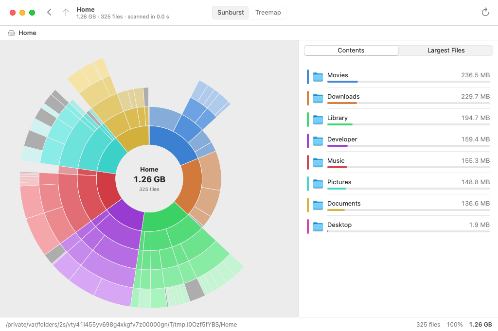
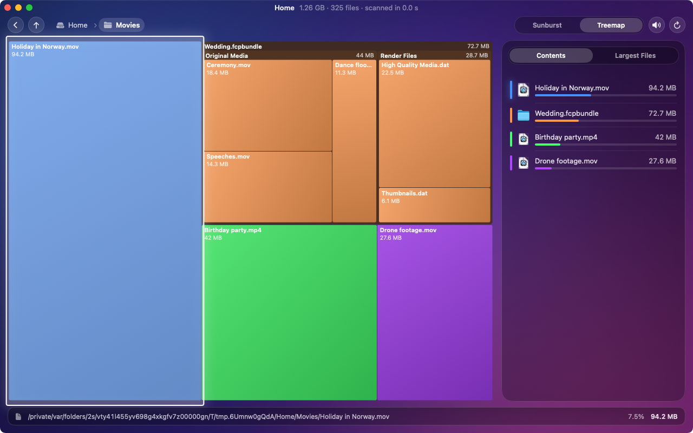
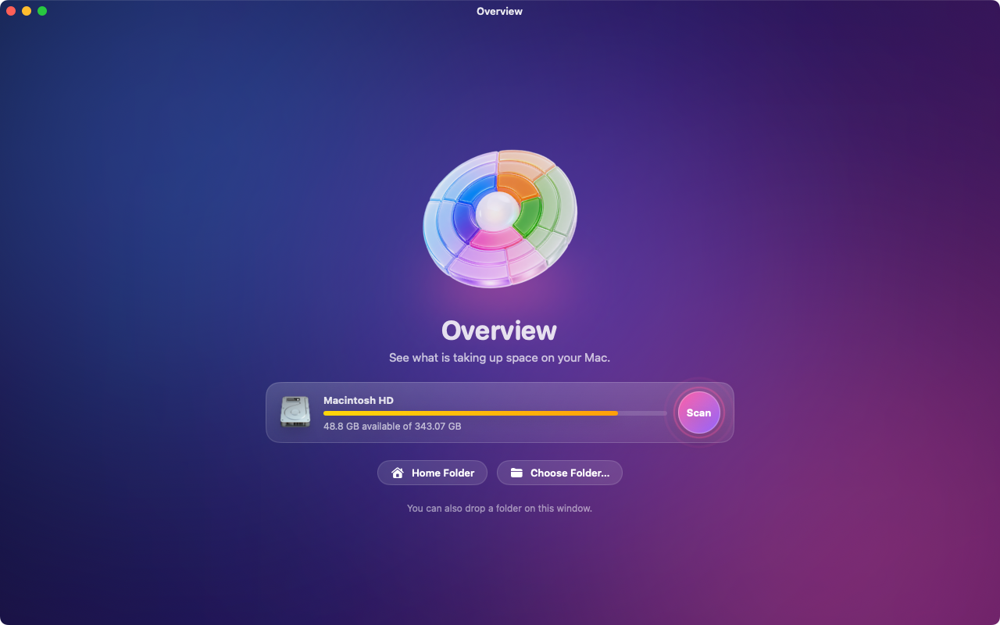
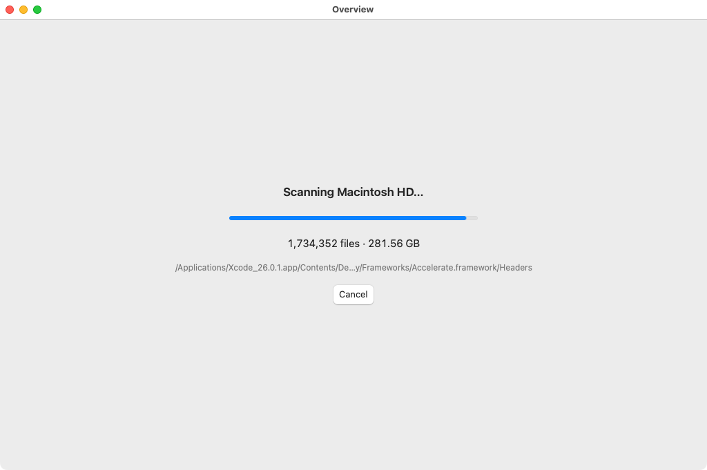

# Overview

## About this publication

This source code accompanies the AI Report masterclass on building software with AI.
You can study, run, fork and adapt the project under the [MIT license](LICENSE).
It is a masterclass example project; no hosted service or ongoing maintenance is offered.

A disk space analyzer for macOS. Overview scans a disk or folder and shows what takes up the space, so you can find the things worth cleaning up.



**[Watch the walkthrough](docs/video/overview-walkthrough.mp4)**: 82 seconds, Dutch voice-over with captions. [docs/video](docs/video) says how it is made.







## What it does

- **Scans a disk or any folder**, in parallel on all cores. Pick a disk or a recent folder on the start screen, choose a folder, or drop one on the window or the Dock icon.
- **Sunburst chart**: the folder in the middle, a ring for every level below it. Click an arc to open that folder, click the middle to go back up.
- **Treemap**: every file as a rectangle whose area is its size, nested by folder. Click to go one level deeper.
- **List next to the chart** with the contents of the folder on screen, largest first, or the 100 largest files anywhere below it.
- **Act on what you find**: show in Finder, copy the path, or move to the Trash. The charts and totals update right away.
- English and Dutch.

## Motion and sound

Version 2 is built to feel alive, in the spirit of MacPaw's apps: a deep gradient with slowly drifting light, glass panels, and springs instead of hard cuts.

- The glass disc on the start screen floats and leans towards the pointer; the cards cascade in; the scan button sends out slow rings.
- While scanning, rings of arcs turn around a running total.
- The sunburst fans open ring by ring and the treemap builds up tile by tile, after every scan and on every step into a folder. Sizes count up, list rows slide in and their bars grow.
- The arc or tile under the pointer lifts out with a spring, and lights up in the list too.
- Six short sounds mark the moments that matter: scan started, scan finished, in, out, select, trash. The speaker button in the window (or File → Sound Effects) turns them off, and they stay silent when "Play user interface sound effects" is off in System Settings.
- Animations follow "Reduce motion" in System Settings; File → Animations overrides that in either direction.

The look started from generated concept images (in [docs/design](docs/design)). The glass disc is a generated illustration, and the sounds and the voice in the video are generated too, all with ElevenLabs.

## Install

Requires macOS 14 or later and the Swift toolchain (Xcode or the Command Line Tools).

```bash
git clone https://github.com/aireport-online/overview.git
```

```bash
cd overview && Scripts/build-app.sh
```

```bash
open build/Overview.app
```

Drag `build/Overview.app` to your Applications folder to keep it. Add `--universal` to the build script for a build that runs on both Apple silicon and Intel (needs Xcode).

Every push is also built on GitHub Actions; the app is attached to the run as the `Overview` artifact. That build is not notarized, so macOS asks for confirmation the first time you open it.

## Full Disk Access

macOS protects some folders (Mail, Messages, Safari data, other apps' containers). Overview tells you when it could not read folders and the totals are therefore incomplete. To see everything, add Overview under System Settings → Privacy & Security → Full Disk Access and scan again.

## How sizes are measured

Overview reports the space a file takes on disk (its allocated blocks), which is what `du` reports and what you get back when you delete it. A few consequences:

- Files that exist only in iCloud take no space and count as zero. Cloud-only folders are not opened, so scanning never triggers downloads.
- Hard-linked files are counted once.
- Other disks mounted inside the scanned folder are skipped. That also keeps a scan of the startup disk from counting your data twice through `/System/Volumes/Data`.
- Space used by APFS snapshots and purgeable space does not belong to any file, so the total of a full-disk scan is lower than the "used" figure of the disk.

A scan of the startup disk of the macOS machine that builds this project (2.3 million files, 285 GB) took 45 seconds and came to 97% of what the disk reports as used.

## Development

```bash
swift test
```

```bash
swift run Overview
```

Launch options, after `swift run Overview` or `open -a Overview --args`:

| Option | Effect |
| --- | --- |
| `-scan /some/folder` | Start scanning that folder right away. |
| `-chartStyle sunburst` or `treemap` | Open with that chart. |
| `-animations on` or `off` | Animate always or never, whatever System Settings says. |
| `-windowSize 1280x800` | Open the window at exactly that size. |

You can also open `Package.swift` in Xcode.

| Path | What is in it |
| --- | --- |
| `Sources/OverviewCore` | The scanner, the file tree and the geometry of both charts. Foundation only, so it also builds and tests on Linux. |
| `Sources/Overview` | The SwiftUI app. |
| `Resources` | `Info.plist`, the icon, the glass disc, the sounds and the Dutch translation. |
| `Scripts/build-app.sh` | Builds `build/Overview.app`. |
| `Scripts/screenshots.sh` | Launches the app on a sample folder, clicks around in it and saves pictures of the window. The build runs it as a check. |
| `Scripts/walkthrough.sh` | Records a scripted tour of the app, driven by `Scripts/pointer.swift`. |
| `Scripts/assemble-video.py` | Turns that recording into the walkthrough video: voice-over, captions and the app's sounds. |
