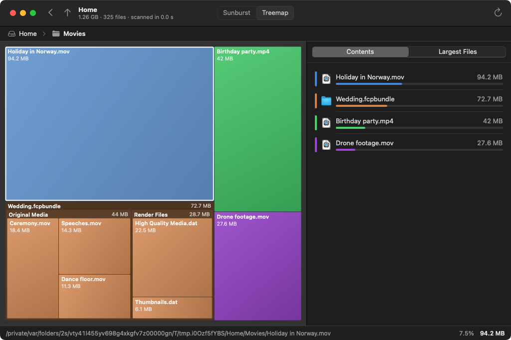
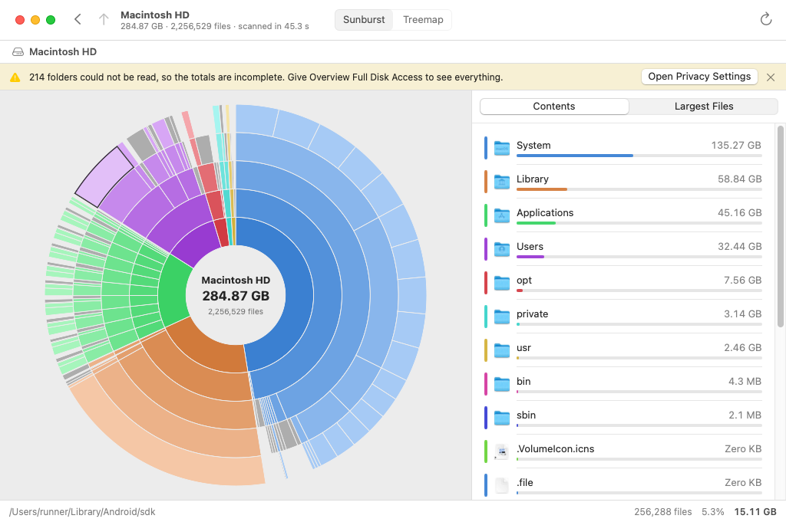

# Overview

A disk space analyzer for macOS. Overview scans a disk or folder and shows what takes up the space, so you can find the things worth cleaning up.




A scan of a whole startup disk (the macOS machine that builds this project: 2.3 million files in 45 seconds):



## What it does

- **Scans a disk or any folder**, in parallel on all cores. Pick a disk on the start screen, choose a folder, or drop one on the window or the Dock icon.
- **Sunburst chart**: the folder in the middle, a ring for every level below it. Click an arc to open that folder, click the middle to go back up.
- **Treemap**: every file as a rectangle whose area is its size, nested by folder. Click to go one level deeper.
- **List next to the chart** with the contents of the folder on screen, largest first, or the 100 largest files anywhere below it.
- **Act on what you find**: show in Finder, copy the path, or move to the Trash. The charts and totals update right away.
- English and Dutch, light and dark mode.

## Install

Requires macOS 14 or later and the Swift toolchain (Xcode or the Command Line Tools).

```bash
git clone https://github.com/aireport-online/overview.git
```

```bash
cd overview && Scripts/build-app.sh
```

```bash
open build/Overview.app
```

Drag `build/Overview.app` to your Applications folder to keep it. Add `--universal` to the build script for a build that runs on both Apple silicon and Intel (needs Xcode).

Every push is also built on GitHub Actions; the app is attached to the run as the `Overview` artifact. That build is not notarized, so macOS asks for confirmation the first time you open it.

## Full Disk Access

macOS protects some folders (Mail, Messages, Safari data, other apps' containers). Overview tells you when it could not read folders and the totals are therefore incomplete. To see everything, add Overview under System Settings → Privacy & Security → Full Disk Access and scan again.

## How sizes are measured

Overview reports the space a file takes on disk (its allocated blocks), which is what `du` reports and what you get back when you delete it. A few consequences:

- Files that exist only in iCloud take no space and count as zero. Cloud-only folders are not opened, so scanning never triggers downloads.
- Hard-linked files are counted once.
- Other disks mounted inside the scanned folder are skipped. That also keeps a scan of the startup disk from counting your data twice through `/System/Volumes/Data`.
- Space used by APFS snapshots and purgeable space does not belong to any file, so the total of a full-disk scan is lower than the "used" figure of the disk.

## Development

```bash
swift test
```

```bash
swift run Overview
```

`swift run Overview -scan /some/folder` starts scanning that folder right away, and `-appearance dark` or `-appearance light` overrides the system appearance. You can also open `Package.swift` in Xcode.

| Path | What is in it |
| --- | --- |
| `Sources/OverviewCore` | The scanner, the file tree and the geometry of both charts. Foundation only, so it also builds and tests on Linux. |
| `Sources/Overview` | The SwiftUI app. |
| `Resources` | `Info.plist`, the icon and the Dutch translation. |
| `Scripts/build-app.sh` | Builds `build/Overview.app`. |
| `Scripts/screenshots.sh` | Launches the app on a sample folder, clicks around in it and saves pictures of the window. The build runs it as a check. |
